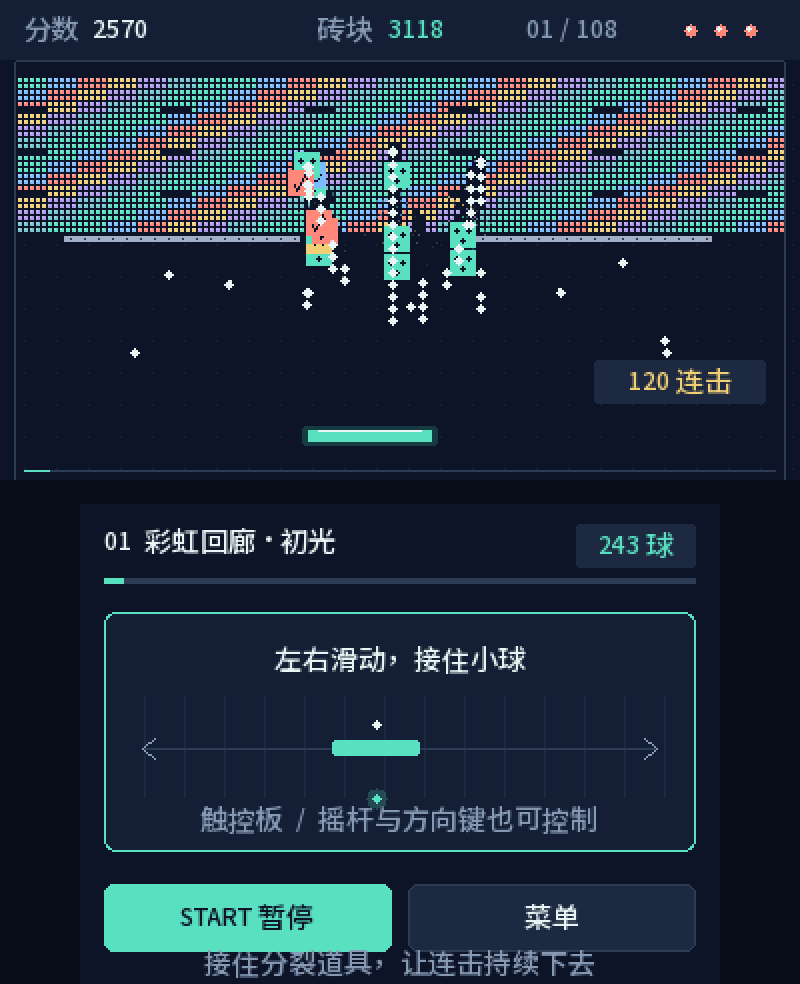

# 万砖齐发 · Many Bricks 3DS

为 Nintendo 3DS 原生制作的中文多球打砖块自制游戏：上屏打砖，下屏触控，108 个原创关卡，最多 256 球同屏。项目参考 Many Bricks Breaker 的核心玩法，独立实现关卡、图形与合成音效，和原作及任天堂均无官方关联。

**当前版本：1.1.1。** 修复挡板迟接、侧面擦碰和快速移动时可能漏球的问题。此修复已通过电脑上的回归测试与 CIA 内容校验，**尚待真机复验**；没有 Old/New 3DS 实测帧率数据。

[下载成品与源码（Releases）](https://github.com/463861437/many-bricks-3ds/releases/latest) · [构建说明](docs/BUILDING.md) · [常见问题](docs/TROUBLESHOOTING.md) · [提交问题](https://github.com/463861437/many-bricks-3ds/issues)



预览由同一套游戏逻辑与绘图代码在电脑生成，主动给予分裂道具展示多球，菜单及结果画面含演示数据；**不是 3DS 真机截图**。[围墙关卡预览](walls-preview.png) · [横屏布局调整对比](layout-comparison.png)

## 特点

- **108 关、9 章**，每章 12 关；每关 2,614–3,238 块 2×2 像素正方形砖块。
- **9 类固定反弹围墙**：回廊、双塔、拱门、阶梯等开放布局；围墙不能破坏，不计入清场数量，没有底部保护墙。
- **最多 256 球**，四种道具：分裂、加长挡板、穿透、慢速。
- 标准与宽松模式，球速缓慢递增并封顶；砖区位于上半屏，围墙与挡板之间至少保留 94 像素距离。
- 触屏、摇杆及十字键控制；中文界面、合成音效、离线游玩。
- 自动保存解锁、成绩及设置，兼容旧版 36 关存档。

## 安装与更新

设备需要已有可运行自制软件的环境；CIA 版还需支持安装自制 CIA。仓库不提供系统改造流程。

1. 从 [最新 Release](https://github.com/463861437/many-bricks-3ds/releases/latest) 下载 CIA，或下载并解压安装包。
2. 将 CIA 复制到 SD 卡的 `/cias/`。版本化文件名和 `many-bricks-3ds.cia` 都可安装。
3. 退出游戏或文件传输程序，打开 **FBI → SD → cias → 选中 CIA → Install CIA**。
4. 回到 HOME 菜单，打开 **万砖齐发**。

已有旧版时，直接覆盖安装即可，通常无需先卸载。更新前可备份 `SD:/3ds/many-bricks-3ds/`；新版沿用相同 Title ID `000400000F7A3300` 和存档位置。此 ID 为项目自选编号，非任天堂官方注册编号。独立分支若要和本作并存，应调整自己的 Title ID 与存档目录。

**Homebrew Launcher 方式**：将 Release 中的 `many-bricks-3ds.3dsx` 与 `many-bricks-3ds.smdh` 放入 `SD:/3ds/many-bricks-3ds/`，通过 Homebrew Launcher 启动。CIA 与 3DSX 版共用同一存档。游戏资源已编入程序，无需另行下载商业 ROM、关卡、图片或音乐。

更简短的随包安装说明见 [INSTALL.txt](INSTALL.txt)。

## 玩法与操作

清除所有砖块即可过关，按顺序解锁下一关。每关有 3 次机会；场上所有球都落底时才扣一次机会。带深色点的砖块需要两次击中。挡板不同位置的接球会改变出射角。

击碎砖块后有 3 秒连击窗口，围墙反弹可累计续时最多 1.25 秒；撞墙本身不加分、不增加连击。穿透球也会被围墙反弹。小球长期未碰砖或挡板时，撞墙会触发方向纠偏，帮助离开空弹循环。

| 道具 | 效果 |
|---|---|
| 青绿三球 · 分裂 | 每个活动球分成三个，总数最多 256 |
| 黄色双箭头 · 加长 | 挡板加长，持续 12 秒 |
| 珊瑚色斜箭头 · 穿透 | 穿过并摧毁砖块，持续 8 秒 |
| 蓝色时钟 · 慢速 | 球速降至 65%，持续 12 秒 |

道具需要用挡板接住。分裂道具在前期及定期击碎砖块后优先出现；同时最多保留 32 个掉落道具。宽松模式有更宽挡板和更低球速，两种模式共享成绩及解锁。

| 场景 | 触屏 | 按键 |
|---|---|---|
| 首页 | 开始/继续、选关、音效、模式按钮 | A 开始，B 选关，X 音效，Y 模式 |
| 选关 | 点已解锁关卡；底部翻页 | 十字键选择，A 进入，L/R 翻页，B 首页 |
| 移动挡板 | 在下屏触控区域左右拖动 | 摇杆或十字键左右 |
| 准备发球 | 点“发球” | A |
| 游戏中暂停 | 点“暂停”或“菜单” | START 或 B |
| 暂停 | 点“继续游戏”或“选择关卡” | A 继续，B 选关 |
| 结果 | 点下一关、重试或返回首页 | A 确认主要按钮，B 选关 |
| 退出 | SELECT 后点退出或取消 | SELECT → A 确认，B 取消 |

HOME/合盖恢复后会暂停，需确认继续。切换画面时先松开按键或触屏，再进行下一操作。进入选关或首页会结束当前局，重新进入从该关开头开始。

## 存档与音效

存档位于：

```text
SD:/3ds/many-bricks-3ds/progress0.bin
SD:/3ds/many-bricks-3ds/progress1.bin
```

两个存档轮流更新，加载时校验格式与校验值，优先使用最近有效记录；一份损坏时尝试恢复另一份。备份或恢复时应退出游戏并同时复制两个文件。`.tmp` 文件不作为有效存档读取。

保存内容包括已解锁关卡、每关最佳成绩、最高分、音效及模式设置，**不保存进行中的球、砖墙和剩余机会**。成绩在暂停、丢球、过关或正常退出等时刻落盘，避免接球过程中写 SD 卡。提示“进度未能保存”时，可继续游玩，但本次进度可能无法保留。

旧版 36 关存档可自动读取，保留解锁、成绩及设置；新增关卡成绩从零开始，下次保存升级格式。旧进度已解锁第 36 关时，再通过该关即可解锁第 37 关。不同版本布局及计分机会有变化，旧成绩作为历史记录保留。新版格式不保证能被旧版读取。

音效由程序生成，使用 libctru NDSP。音频初始化失败时可无声运行；发行包不包含 DSP 固件。

## 开发与验证

主要代码为 C++17，使用 devkitARM/libctru；无需商业引擎。已验证构建使用 GCC 16.1.0、libctru 2.7.0、makerom 0.18.4 和 bannertool 1.2.0。

配置好工具链后，在仓库根目录运行：

```sh
./build.sh -j4                 # ELF、3DSX、SMDH
./build-cia.sh                 # CIA 与 map
./check.sh                     # 电脑端回归测试，需支持 ASan/UBSan 的 C++17 编译器
```

详细依赖安装、环境变量、CIA 校验、预览生成和打包见 [BUILDING.md](docs/BUILDING.md)。源码结构、碰撞逻辑与扩展关卡流程见 [ARCHITECTURE.md](docs/ARCHITECTURE.md)。

1.1.1 已完成挡板、物理、存档/输入、渲染、音频调用、主循环等电脑端测试，以及 CIA 内容和权限校验。硬件接口的测试替身不能证明真机声音、触屏时序、帧率或 SD 断电安全；压力模拟也不等于 108 关已逐关人工通关。完整记录与边界见 [VALIDATION.md](VALIDATION.md)。

## 贡献与许可

欢迎通过 [Issues](https://github.com/463861437/many-bricks-3ds/issues) 报告问题或提出关卡建议，提交代码前请阅读 [CONTRIBUTING.md](CONTRIBUTING.md)。版本变化见 [CHANGELOG.md](CHANGELOG.md)。

项目代码、原创关卡、图形和合成音效采用 **GPL-3.0-or-later**，见 [LICENSE](LICENSE)。Noto Sans SC 字体、libctru 及运行时依赖保留各自许可，详见 [THIRD_PARTY.md](THIRD_PARTY.md)。构建工具和商业游戏内容不随项目分发。

玩法参考 [FujiCubeSoft 的 Many Bricks Breaker](https://store.steampowered.com/app/1604020/)。本项目不是原作源代码移植，未复制其商业程序、图片、音乐或关卡数据。
